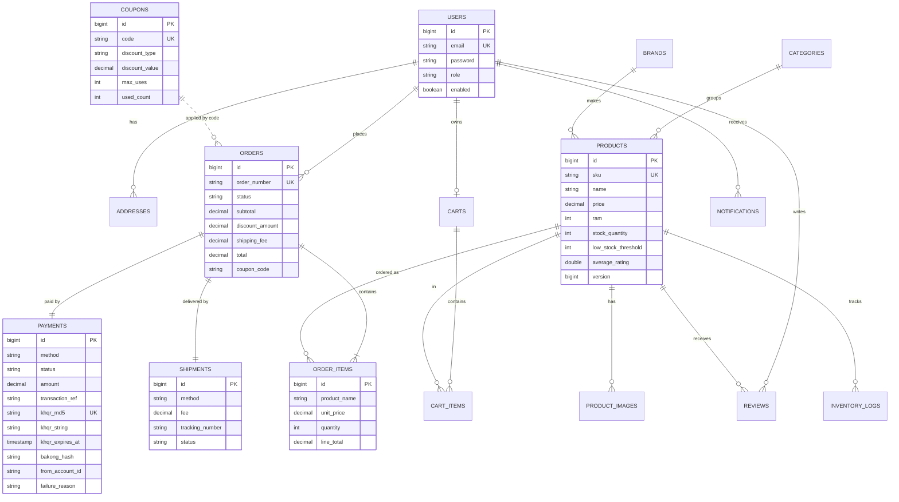

# ecom - computer store REST API (Spring Boot)

Backend for **ecom**, a simple online store that sells computers (laptops, desktops, monitors, components, accessories).
It covers the 16 core e-commerce components from the course: users, catalog, cart, orders, payments (simulated KHQR), inventory, checkout,
shipping, search & filtering, reviews, promotions, notifications, admin panel, reports and file uploads.
The Next.js web app and the Flutter mobile app are built on top of this API - see [`API_CONTRACT.md`](API_CONTRACT.md).

## Tech stack
Java 21, Spring Boot 3.3.5, Maven, Spring Web / Data JPA / Validation / Security (JWT, jjwt 0.12), PostgreSQL 16 (dev and tests, tests via Testcontainers),
Flyway, Bakong KHQR SDK, springdoc-openapi (Swagger UI), Lombok, JUnit 5, Mockito, MockMvc, WireMock, AssertJ, JaCoCo.

## Requirements
- JDK 21 (`java -version`) - set `JAVA_HOME` to it if several JDKs are installed
- Maven 3.9+
- Docker - for PostgreSQL and for the integration tests (Testcontainers starts `postgres:16-alpine`). A local PostgreSQL 16 also works for running the app

## 1. Create the database
**Option A - Docker (recommended):**
```bash
docker compose up -d                    # PostgreSQL 16 on :5432  (db ecom_db, user ecom, password ecom123)
docker compose --profile tools up -d    # + pgAdmin on http://localhost:5050 (admin@ecom.com / admin123)
# if port 5432 is already in use on your machine:
PG_PORT=5439 docker compose up -d       # then start the app with DB_URL=jdbc:postgresql://localhost:5439/ecom_db
```
**Option B - local PostgreSQL:**
```sql
CREATE USER ecom WITH PASSWORD 'ecom123';
CREATE DATABASE ecom_db OWNER ecom;
```
Tables and catalog seed data are created by Flyway (`V1__init.sql`, `V2__seed.sql`, `V3__bakong_khqr.sql`) on first start. The demo users are created by `DataSeeder` (dev profile only).

## 2. Configuration
`src/main/resources/application-dev.yml` (already included; every value can be overridden by an environment variable):
```yaml
spring:
  datasource:
    url: ${DB_URL:jdbc:postgresql://localhost:5432/ecom_db}
    username: ${DB_USERNAME:ecom}
    password: ${DB_PASSWORD:ecom123}
  jpa:
    hibernate.ddl-auto: validate
    open-in-view: false
    properties.hibernate.jdbc.time_zone: Asia/Phnom_Penh
app:
  cors:
    allow-all: true        # dev only; otherwise only app.cors.allowed-origins (http://localhost:3000) is allowed
```
Other settings (`application.yml`): `KHQR_MODE` and the `BAKONG_*` variables (see below), `JWT_SECRET` (use a long random value outside dev), `app.jwt.expiration-ms` (24 h), `app.upload-dir` (`./uploads`).

## 3. Run
```bash
mvn spring-boot:run -Dspring-boot.run.profiles=dev      # API on http://localhost:8080
mvn clean verify                                        # compile + all tests (needs Docker) + JaCoCo coverage check
cp .env.example .env                                    # optional: put KHQR_MODE / BAKONG_* here, then `set -a; . ./.env; set +a`
```
- Swagger UI: http://localhost:8080/swagger-ui.html - OpenAPI JSON: http://localhost:8080/v3/api-docs
- Coverage report: `target/site/jacoco/index.html` (the build fails if line coverage of `com.ecom.service.impl` drops below 80%)

## Demo accounts (dev profile)
| Role | Email | Password |
|---|---|---|
| ADMIN | admin@ecom.com | Admin@123 |
| STAFF | staff@ecom.com | Staff@123 |
| CUSTOMER | customer@ecom.com | Customer@123 (has a default address in Phnom Penh) |

Coupons: `WELCOME10` (10%), `SAVE50` ($50 off orders of $500+), `EXPIRED` (expired, for testing).
Catalog: 5 categories, 9 brands (the 7 from the brief plus Samsung and Logitech, needed by the SSD and mouse products), 29 products, 3 of them with low stock.

## Bakong KHQR setup (real payments)
By default `KHQR_MODE=mock`: QR codes are fake and payments are confirmed through `POST /api/v1/payments/callback`. Switch to real Bakong KHQR like this.

**1. Get the credentials**
1. Open a Bakong account and complete KYC (the account must be fully verified). Your **Bakong account ID** looks like `yourname@bank`.
2. Register at https://api-bakong.nbc.gov.kh with your email to get a **Bakong Open API token** (a JWT).
3. The token **expires** (tokens are valid for a limited time). When it does, the status endpoint answers `502` and the log shows `Bakong token expired - renew it`; request a new token on the same site and restart with the new `BAKONG_TOKEN`.

**2. Environment variables** (see `.env.example`; never commit real values - `.env` is git-ignored)

| Variable | Meaning | Default |
|---|---|---|
| `KHQR_MODE` | `mock` or `bakong` | `mock` |
| `BAKONG_TOKEN` | Open API token (required in bakong mode) | - |
| `BAKONG_ACCOUNT_ID` | account that receives the money, e.g. `yourname@bank` (required in bakong mode) | - |
| `BAKONG_BASE_URL` | Open API base URL | `https://api-bakong.nbc.gov.kh` |
| `BAKONG_MERCHANT_NAME` / `BAKONG_MERCHANT_CITY` | printed in the customer's banking app | `ECOM Computer Store` / `Phnom Penh` |
| `BAKONG_CURRENCY` | `USD` or `KHR` | `USD` |
| `BAKONG_KHR_PER_USD` | conversion rate, only used for `KHR` | `4100` |
| `KHQR_AUTO_CANCEL_MINUTES` | unpaid KHQR orders are cancelled after this many minutes (`0` = never) | `30` |
| `KHQR_LATE_PAYMENT_WATCH_HOURS` | bakong mode: keep checking auto-cancelled KHQR orders for a late payment this long (`0` = off) | `24` |

With `KHQR_MODE=bakong` the app refuses to start if the token or account ID is empty.

**3. Run**
```bash
KHQR_MODE=bakong BAKONG_TOKEN=... BAKONG_ACCOUNT_ID=yourname@bank mvn spring-boot:run -Dspring-boot.run.profiles=dev
```

**4. How it works**
- Checkout with `paymentMethod: KHQR`, then `POST /payments/{orderNumber}/khqr` builds a dynamic KHQR for the exact order total with the official NBC SDK (offline) and stores its MD5. The same QR is returned until it expires (10 minutes).
- Bakong sends **no webhook**. The backend asks `POST /v1/check_transaction_by_md5` on demand (when the client polls `GET /payments/{orderNumber}/status`, at most once per 3 s per payment) and from a background job every 5 s (`KhqrPaymentReconciler`).
- A payment is marked PAID only if Bakong reports it **and** the amount, currency and receiving account match. Otherwise it becomes FAILED with a reason and the admins are notified. Confirming is idempotent (conditional update), so polling and the job can run at the same time.
- A QR still unpaid 5 minutes after it expired becomes FAILED (`QR expired`); the order stays PENDING and the customer can request a new QR.
- **Auto-cancel:** a job (every minute, `payment.khqr.auto-cancel-check-interval-ms`; runs in mock mode too) cancels KHQR orders that are still unpaid `payment.khqr.auto-cancel-minutes` (default 30) after creation: order `CANCELLED` with reason `KHQR payment timeout`, stock restored (inventory log `CANCEL`), payment `FAILED`, customer notified. Paid, young and cash-on-delivery orders are never touched; a payment confirmed at the same moment wins the race (conditional update).
- **Late payments:** in bakong mode `KhqrLatePaymentWatcher` (every `payment.khqr.late-payment-check-interval-ms`, default 60 s) keeps checking the MD5 of auto-cancelled orders for `payment.khqr.late-payment-watch-hours` (default 24) after the cancel. If Bakong reports it paid with the same amount/currency/receiving account, the payment becomes `PAID_AFTER_CANCEL`, the order **stays CANCELLED**, stock is **not** re-reserved, and all admins get a `HIGH`-priority notification "Customer paid after cancel - refund or restore order". Find them with `GET /admin/payments?status=PAID_AFTER_CANCEL`. The admin then either `POST /admin/orders/{orderNumber}/restore-after-payment` (re-checks stock, re-reserves, order CONFIRMED, payment PAID; **409** if out of stock, nothing changes) or `POST /admin/payments/{orderNumber}/refund` (also accepts the payment id). A late payment with a wrong amount/currency/account is never accepted: the watch stops and admins are alerted once. Needs migration `V4__late_payment_after_cancel.sql` (applied automatically by Flyway).
- **Paid signal:** only `responseCode == 0` with a non-null `data` object counts as paid; any other answer means "not paid yet" and polling continues. Set the logger `com.ecom.service.impl.BakongKhqrGateway` to `DEBUG` (e.g. `LOGGING_LEVEL_COM_ECOM_SERVICE_IMPL_BAKONGKHQRGATEWAY=DEBUG`) to log the full raw Bakong JSON and compare it with a real response.
- `POST /payments/callback` answers 404 in bakong mode. `POST /admin/payments/{orderNumber}/recheck` (ADMIN) re-checks one payment immediately.

**5. Network note:** the Bakong Open API may only accept requests from Cambodian IP addresses. If your server runs outside Cambodia, run it on a Cambodian VPS or send the calls through a Cambodian proxy; otherwise status checks time out (HTTP 504).

**6. Manual live test (real money, tiny amount)**
1. Start the app with the variables above. Log in as admin, create a cheap product (e.g. price `0.01`, stock 5; shipping/discounts add to the total, so use `FIXED` coupon or accept the $5 shipping, or create a product at `0.01` and a coupon that covers shipping).
2. As the customer: add it to the cart, checkout with `paymentMethod: KHQR`, call `POST /api/v1/payments/{orderNumber}/khqr` and render `data.qrString` as a QR code (any QR generator).
3. Scan it with the Bakong app or another KHQR bank app (ACLEDA, ABA, Wing, ...). The amount and merchant name are pre-filled; pay.
4. Within ~5-10 seconds `GET /api/v1/payments/{orderNumber}/status` returns `PAID`, the order is `CONFIRMED` and a "Payment received" notification exists. If it does not, check the log for `Bakong` messages (token, IP restriction) and try the admin recheck endpoint.
5. Cancel the order as admin or refund the $0.01 manually afterwards.

## Manual testing
- Postman: import `postman/ecom-api.postman_collection.json` and `postman/ecom-local.postman_environment.json`, select the *ecom-local* environment and run the whole collection with the Collection Runner (folders `01`...`16` run in order; tokens and ids are stored automatically). The upload request uses `postman/sample.png`.
- Command line: `npx newman run postman/ecom-api.postman_collection.json -e postman/ecom-local.postman_environment.json --working-dir postman`
- `http/ecom.http` - the same requests for VS Code REST Client / IntelliJ HTTP Client.

## Endpoints
Details and JSON examples for every endpoint: [`API_CONTRACT.md`](API_CONTRACT.md).

| Method | Path | Access |
|---|---|---|
| `POST` | `/api/v1/auth/register` | Public |
| `POST` | `/api/v1/auth/login` | Public |
| `GET` | `/api/v1/users/me` | Authenticated |
| `PUT` | `/api/v1/users/me` | Authenticated |
| `PUT` | `/api/v1/users/me/password` | Authenticated |
| `GET` | `/api/v1/users/me/addresses` | Authenticated |
| `POST` | `/api/v1/users/me/addresses` | Authenticated |
| `PUT` | `/api/v1/users/me/addresses/{{newAddressId}}` | Authenticated |
| `PATCH` | `/api/v1/users/me/addresses/{{newAddressId}}/default` | Authenticated |
| `PATCH` | `/api/v1/users/me/addresses/{{addressId}}/default` | Authenticated |
| `DELETE` | `/api/v1/users/me/addresses/{{newAddressId}}` | Authenticated |
| `GET` | `/api/v1/products` | Public |
| `GET` | `/api/v1/products/{{productId}}` | Public |
| `GET` | `/api/v1/products/slug/{{productSlug}}` | Public |
| `GET` | `/api/v1/categories` | Public |
| `GET` | `/api/v1/brands` | Public |
| `GET` | `/api/v1/shipping/methods` | Public |
| `GET` | `/api/v1/cart` | Authenticated |
| `POST` | `/api/v1/cart/items` | Authenticated |
| `PUT` | `/api/v1/cart/items/{{itemId}}` | Authenticated |
| `POST` | `/api/v1/cart/apply-coupon` | Authenticated |
| `DELETE` | `/api/v1/cart/items/{{itemId}}` | Authenticated |
| `POST` | `/api/v1/orders/checkout` | Authenticated |
| `GET` | `/api/v1/orders` | Authenticated |
| `GET` | `/api/v1/orders/{{orderNumber}}` | Authenticated |
| `GET` | `/api/v1/orders/{{orderNumber}}/invoice` | Authenticated |
| `GET` | `/api/v1/orders/{{orderNumber}}/tracking` | Authenticated |
| `POST` | `/api/v1/orders/{{codOrderNumber}}/cancel` | Authenticated |
| `POST` | `/api/v1/payments/{{orderNumber}}/khqr` | Authenticated |
| `GET` | `/api/v1/payments/{{orderNumber}}/status` | Authenticated |
| `POST` | `/api/v1/payments/callback` | Public |
| `POST` | `/api/v1/admin/payments/{{orderNumber}}/recheck` | ADMIN |
| `PATCH` | `/api/v1/admin/orders/{{orderNumber}}/status` | ADMIN, STAFF |
| `PATCH` | `/api/v1/admin/orders/{{orderNumber}}/ship` | ADMIN, STAFF |
| `PATCH` | `/api/v1/admin/shipments/{{shipmentId}}/status` | ADMIN, STAFF |
| `POST` | `/api/v1/products/{{productId}}/reviews` | Authenticated |
| `GET` | `/api/v1/products/{{productId}}/reviews` | Public |
| `PUT` | `/api/v1/reviews/{{reviewId}}` | Authenticated |
| `GET` | `/api/v1/notifications` | Authenticated |
| `GET` | `/api/v1/notifications/unread-count` | Authenticated |
| `PATCH` | `/api/v1/notifications/{{notificationId}}/read` | Authenticated |
| `PATCH` | `/api/v1/notifications/read-all` | Authenticated |
| `GET` | `/api/v1/admin/users` | ADMIN |
| `PATCH` | `/api/v1/admin/users/{{regUserId}}/role` | ADMIN |
| `PATCH` | `/api/v1/admin/users/{{regUserId}}/enabled` | ADMIN |
| `GET` | `/api/v1/admin/products` | ADMIN |
| `POST` | `/api/v1/admin/products` | ADMIN |
| `GET` | `/api/v1/admin/products/{{newProductId}}` | ADMIN |
| `PUT` | `/api/v1/admin/products/{{newProductId}}` | ADMIN |
| `PATCH` | `/api/v1/admin/products/{{newProductId}}/active` | ADMIN |
| `DELETE` | `/api/v1/admin/products/{{newProductId}}` | ADMIN |
| `POST` | `/api/v1/admin/categories` | ADMIN |
| `PUT` | `/api/v1/admin/categories/{{newCategoryId}}` | ADMIN |
| `DELETE` | `/api/v1/admin/categories/{{newCategoryId}}` | ADMIN |
| `POST` | `/api/v1/admin/brands` | ADMIN |
| `PUT` | `/api/v1/admin/brands/{{newBrandId}}` | ADMIN |
| `DELETE` | `/api/v1/admin/brands/{{newBrandId}}` | ADMIN |
| `GET` | `/api/v1/admin/orders` | ADMIN |
| `GET` | `/api/v1/admin/orders/{{orderNumber}}` | ADMIN |
| `GET` | `/api/v1/admin/payments` | ADMIN |
| `POST` | `/api/v1/admin/payments/{{paymentId}}/refund` | ADMIN |
| `GET` | `/api/v1/admin/coupons` | ADMIN |
| `POST` | `/api/v1/admin/coupons` | ADMIN |
| `PUT` | `/api/v1/admin/coupons/{{couponId}}` | ADMIN |
| `DELETE` | `/api/v1/admin/coupons/{{couponId}}` | ADMIN |
| `GET` | `/api/v1/admin/inventory` | ADMIN, STAFF |
| `GET` | `/api/v1/admin/inventory/low-stock` | ADMIN, STAFF |
| `POST` | `/api/v1/admin/inventory/{{productId}}/restock` | ADMIN, STAFF |
| `POST` | `/api/v1/admin/inventory/{{productId}}/adjust` | ADMIN, STAFF |
| `GET` | `/api/v1/admin/inventory/{{productId}}/logs` | ADMIN, STAFF |
| `GET` | `/api/v1/admin/reviews` | ADMIN |
| `PATCH` | `/api/v1/admin/reviews/{{reviewId}}/visibility` | ADMIN |
| `DELETE` | `/api/v1/admin/reviews/{{reviewId}}` | ADMIN |
| `GET` | `/api/v1/admin/reports/dashboard` | ADMIN |
| `GET` | `/api/v1/admin/reports/sales` | ADMIN |
| `POST` | `/api/v1/admin/uploads` | ADMIN |

## Architecture
Package-by-layer under `com.ecom`: `controller` (one per module; admin under `/api/v1/admin/**`), `service` + `service/impl`,
`repository`, `model/{entity,enumerate,request,response}` (entities are never returned - DTOs only), `security` (JWT), `config`, `common` (envelope, exceptions), `util`.
- **Money** is always `BigDecimal` with scale 2 (HALF_UP).
- **Checkout** runs in one `@Transactional` method; **overselling** is prevented by a stock check plus optimistic locking (`@Version` on `Product`) - concurrent buyers of the last unit get 201 / 409.
- **KHQR** goes through the `KhqrGateway` interface: `MockKhqrGateway` (mode `mock`) or `BakongKhqrGateway` (mode `bakong`), chosen by `payment.khqr.mode`.
- **Notifications** are stored in the database and handed to `NotificationSender`s (`EmailSender`, `SmsSender`, `PushSender`) that only write to the log for now.
- `GET /products` uses JPA Specifications for combined filters and sorting.
- `POST /payments/callback` is public by design but only exists in mock mode (404 in bakong mode).

## ERD


## Tests
`mvn clean verify` needs Docker: integration tests run on a real **PostgreSQL 16** started by Testcontainers (`test` profile, same Flyway migrations as production). The real Bakong API is never called - WireMock plays Bakong. If your Docker daemon rejects the default client API version, override it with `-Ddocker.api.version=<version>` (default `1.44`).
- `src/test/java/com/ecom/service` - Mockito unit tests (auth, cart, coupon, order, payment, review, inventory)
- `src/test/java/com/ecom/controller` - `@SpringBootTest` + MockMvc integration tests for every controller (200/201, 400, 401, 403, 404, 409), customer-vs-customer isolation, search/filter/paging
- `PurchaseFlowIntegrationTest` - register -> login -> search -> cart -> coupon -> KHQR checkout -> callback -> admin fulfilment -> delivery -> 5-star review
- `KhqrAutoCancelIntegrationTest` - unpaid KHQR orders cancelled after the timeout, stock restored, others untouched
- `KhqrLatePaymentIntegrationTest` - WireMock: pay after auto-cancel -> `PAID_AFTER_CANCEL` + HIGH admin notification, restore (200 / 409 out of stock / 400), refund by order number, mismatch, expired watch window
- `BakongModeIntegrationTest` - `KHQR_MODE=bakong` with WireMock: QR, polling, mismatches, rate limit, expiry, token errors, scheduler, callback 404
- `BakongKhqrGatewayTest` / `KhqrSettlementTest` - Bakong responses (paid, not found, 401, timeout, malformed), offline QR validity via the SDK, idempotent settlement
- `ConcurrencyIntegrationTest` - two customers racing for the last unit, repeated 3 times
